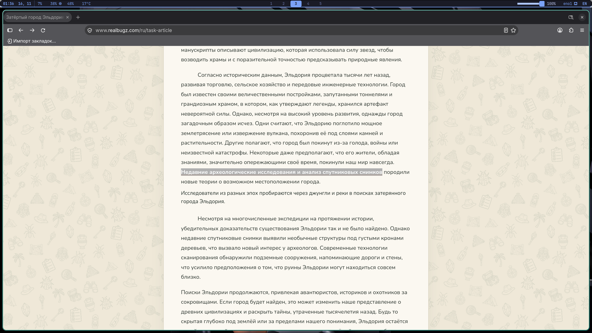
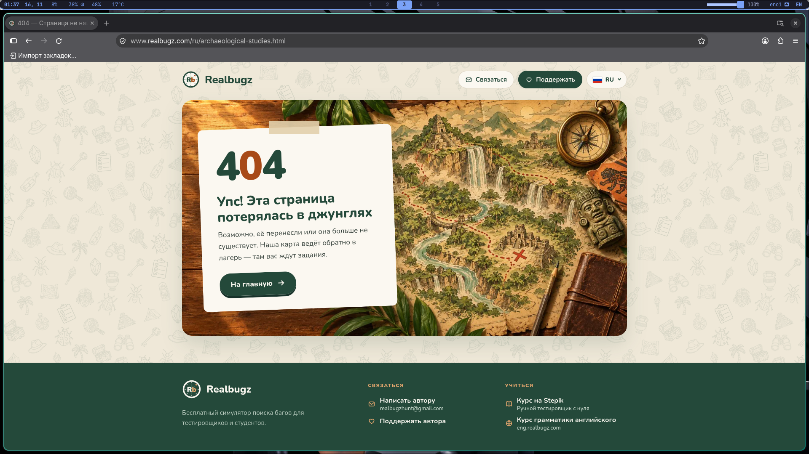

### ID
BUG-003
___
### Тип
Функциональный дефект (Broken Link)
___
### Статус
Open
___
### Серьёзность (Severity)
Low
___
### Приоритет (Priority)
Medium
___

### Окружение

- **Браузер:** Firefox 159.0.1
- **ОС:** CachyOS
- **Сайт:** https://www.realbugz.com/ru/task-article
- **Устройство:** ПК

___

### Предусловия

Открыт доступ к странице статьи:
https://www.realbugz.com/ru/task-article

___

### Шаги воспроизведения

1. Открыть страницу статьи: https://www.realbugz.com/ru/task-article
2. Найти в тексте анкор-ссылку с текстом:
   `Недавние археологические исследования и анализ спутниковых снимков`
3. Нажать на эту гиперссылку.
4. Дождаться загрузки страницы.

### Ожидаемый результат
Пользователь переходит на страницу с дополнительной информацией об археологических исследованиях. Страница существует и отображает релевантный контент.

### Фактический результат
Пользователь переходит на несуществующую страницу и получает ошибку **404 Not Found** по адресу:
`https://www.realbugz.com/ru/archaeological-studies.html`

___

### Влияние (Impact)
- Пользователь не может получить информацию, на которую рассчитывал при переходе по ссылке.
- Ухудшается пользовательский опыт и доверие к сайту.
- Дефект не влияет на безопасность и не приводит к утечке данных.

___

### Доказательства

- 

- 

- 

### Рекомендация по исправлению
Проверить значение `href` у анкор-ссылки. Один из вариантов:
- Исправить путь на существующую страницу.
- Удалить ссылку, если страница больше не существует.
- Настроить редирект на актуальную страницу.

#### Автор
FrozenTouch (Александр)
