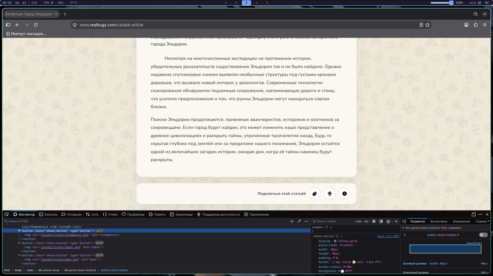

### ID
BUG-005
___
### Тип
Функциональный дефект (Non-functional "Share" button)
___
### Статус
Open
___
### Серьёзность (Severity)
Low
___
### Приоритет (Priority)
High
___

### Окружение

- **Браузер:** Firefox 159.0.1
- **ОС:** CachyOS
- **Сайт:** https://www.realbugz.com/ru/task-article
- **Устройство:** ПК

___

### Предусловия

Открыт доступ к странице статьи:
https://www.realbugz.com/ru/task-article

___

### Шаги воспроизведения

1. Открыть страницу статьи: https://www.realbugz.com/ru/task-article
2. Спуститься в самый низ страницы
3. Найти кнопки `Поделиться`
4. Нажать любую из трех кнопок `Поделиться`

### Ожидаемый результат
Пользователь перенаправляет на сайт где он сможет поделиться статьей 

### Фактический результат
Ничего не происходит при нажатие кнопок `Поделиться`

___

### Влияние (Impact)
- Пользователь не может поделиться статьей из за чего о статье узнает меньше людей.
- Ухудшается пользовательский опыт.
- Дефект не влияет на безопасность и не приводит к утечке данных.

___

### Доказательства

- 

### Рекомендация по исправлению
В HTML-коде кнопка реализована через тег `<button>`, который не имеет атрибута `href` для перехода и `onclick` для вызова JavaScript.

1. Заменить тег `<button>` на тег `<a>` с атрибутом `href="https://twitter.com/intent/tweet..."` (для каждой соцсети свой URL).
    
2. Или добавить на кнопку JavaScript-обработчик `onclick`, который будет открывать окно шаринга.

#### Автор
FrozenTouch (Александр)
